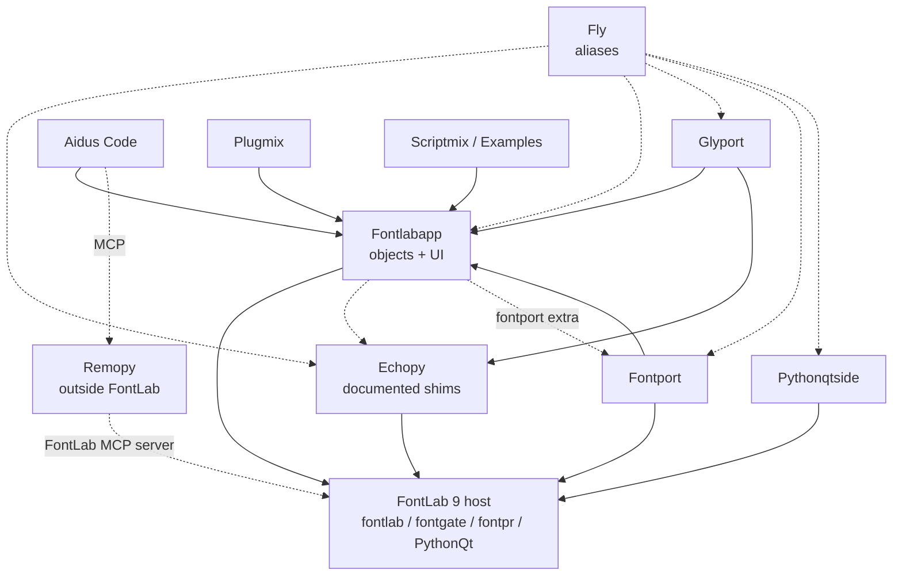

# Ecosystem and package boundaries

The FontLab Python packages split by one question: where does your code run, and
what does it need to talk to? Each package owns one answer. Pick the package that
matches your answer instead of reaching across a boundary.

| Package | Role |
| --- | --- |
| [Remopy](remopy.md) | Pip-installable remote control of a running FontLab from an ordinary Python process outside it. |
| [Glyport](glyport.md) | Runs unmodified Glyphs.app scripts and plugins inside FontLab. |
| [Fontport](fontport.md) | FontParts, fontTools pens, UFO and DesignSpace interoperability. No user interface. |
| [Echopy](echopy.md) | Generates documented, pure-Python passthrough shims of `fontlab`, `fontgate`, `fontpr`, `fontlabpr`, `FL` and `PythonQt`. |
| [Fontlabapp](fontlabapp.md) | The large object and UI API: menus, panels, windows, drawing overlays, dialogs. |
| [Fly](fly.md) | Nine short, lazy import aliases for the packages above. It adds no behaviour. |
| [Aidus Code](aidus-code.md) | An in-FontLab coding agent with a graphical dock. |
| [Pythonqtside](pythonqtside.md) | Runs PySide2-style code on FontLab's PythonQt. |
| [Scriptmix](scriptmix.md) | A collection of practical menu scripts for FontLab 9. |
| [Examples](examples.md) | PythonQt-rich example scripts that show how to build panels and tools. |
| [Plugmix](plugmix.md) | New: native FontLab plugins, reporters, filters, palettes, tools and General plugins. |

## How the packages depend on each other

Arrows point from a package to what it builds on. Dashed arrows are optional or
planned.

The same dependencies as a plain list:

- Echopy, Fontlabapp, Pythonqtside and Fontport build on the FontLab host.
- Glyport builds on Fontlabapp and Echopy.
- Plugmix, Aidus Code, Scriptmix and Examples build on Fontlabapp.
- Fontport requires Fontlabapp; Fontlabapp's Qt editors call Fontport lazily through its `fontport` extra.
- Aidus Code can reach FontLab from outside through Remopy.
- Remopy talks to FontLab's native MCP server, not to the host modules.
- Fly optionally aliases Echopy, Fontlabapp, Glyport, Fontport and Pythonqtside.

Two edges are worth stating in words. Remopy never imports the host: it talks to
FontLab's native MCP server, so it runs anywhere Python runs. Fly imports nothing
until you ask for an alias, so importing it never loads a target package.

## Where does my code go?

| You want to... | Use |
| --- | --- |
| Run a script from a terminal, CI job or notebook against a running FontLab | Remopy |
| Run a Glyphs.app script or plugin without rewriting it | Glyport |
| Read or write UFO, DesignSpace or FontParts objects, or draw with fontTools pens | Fontport |
| Look up what a native FontLab class or method accepts | Echopy reference |
| Add a menu item, dock, dialog or drawing overlay | Fontlabapp |
| Reuse PySide2 code in FontLab | Pythonqtside |
| Draw an always-available read-only overlay in the Glyph window | [Plugmix](plugmix.md) reporters, or the [native hooks](../guide/native-hooks.md) directly |
| Add a custom editing tool | A [Plugmix](plugmix.md) Tool, or the [native hooks](../guide/native-hooks.md) (`registerPythonTool`) |
| Write a short script and share it as a menu entry | Scriptmix conventions, built on Fontlabapp |
| Ask an AI agent to inspect or edit the font | Aidus Code |

## Boundary rules

- **Outside versus inside.** Remopy is the only package meant for code outside
  FontLab. Everything else imports FontLab's own modules and needs the host.
- **Interop versus UI.** Fontport converts font data and has no user interface.
  Its Qt editors live in `fontlabapp.fontui` and call Fontport lazily.
- **Shims versus behaviour.** Echopy documents and mirrors the native API. It does
  not add features. Behaviour that goes beyond the native API belongs in
  Fontlabapp.
- **Compatibility layers stay separate.** Glyport carries Glyphs.app behaviour;
  Pythonqtside carries PySide2 behaviour. Neither leaks into Fontlabapp.
- **Aliases are not an API.** Fly resolves names; it never wraps or extends the
  module it returns.
